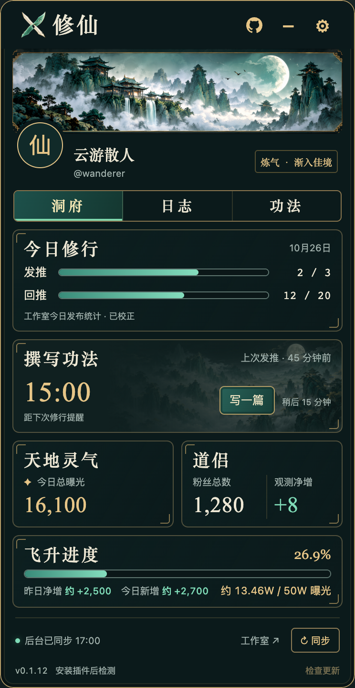
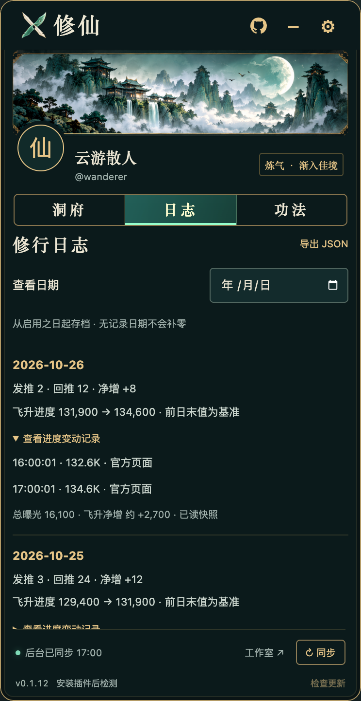
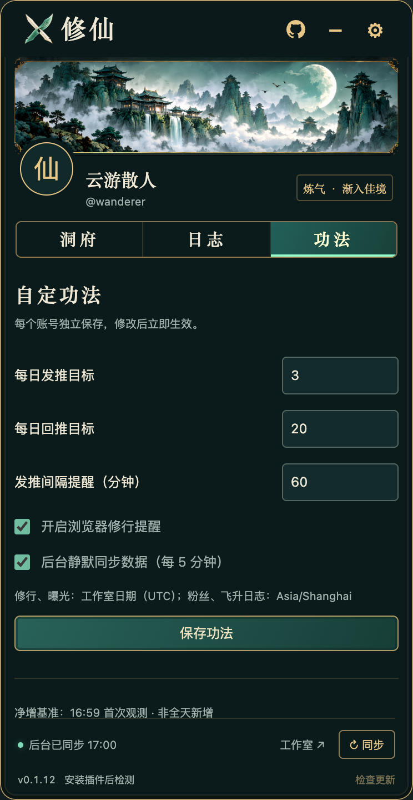
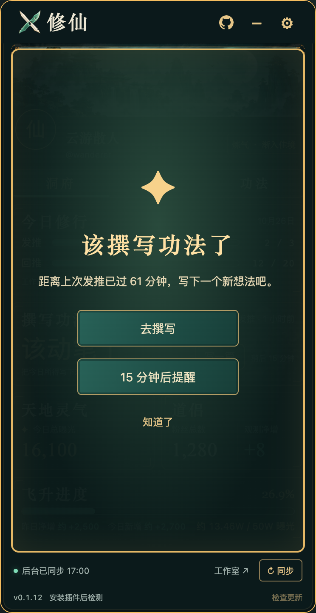

[简体中文](README.md) · [English](README.en.md)

<div align="center">
  
  <h1>X 修仙 · 创作者洞府</h1>
  <p>在 X 页面里，把每日创作、交流与数据增长，收进一座修仙洞府。</p>
  <p>
    
    
    
    
  </p>
  <p><a href="https://github.com/zkilxx/x-xiuxian/releases/latest">下载插件</a> · <a href="#安装">安装方法</a> · <a href="#使用">使用说明</a> · <a href="https://github.com/zkilxx/x-xiuxian/issues">反馈问题</a></p>
</div>

<p align="center"></p>

无需 API Key，无需构建。读取当前登录的 X 账号，设置每日发推与回推目标，查看撰写倒计时、今日总曝光、粉丝变化和原创内容奖励进度。发布成功即时记数，后台每 5 分钟依次同步奖励、工作室分析与粉丝资料，用工作室数据校正每日修行。

> 本文截图由插件实际界面渲染，使用「云游散人 / @wanderer」演示资料与固定日期，不包含真实账号数据。README 提供中英文版本，插件当前操作界面为中文。

## 能做什么

| 功能 | 说明 |
| --- | --- |
| 悬浮洞府 | 拖动标题栏自由移动并记住位置，收起为圆角方形刀剑 X；首页自动适应窗口高度 |
| 账号同步 | 显示当前登录账号的头像、昵称和 @ID，任务、设置与记录按账号隔离 |
| 每日修行 | 自定发推与回推目标；发布成功后立即计数，后台按工作室统计补齐和校正 |
| 静默反馈 | 不弹出频繁的成功提示；回复成功时在原回复按钮上淡入淡出绿色 `+1` |
| 撰写功法 | 显示距离上次发推的时间与提醒倒计时，到时持续提醒，可去撰写、稍后 15 分钟或确认 |
| 天地灵气 | 显示工作室当天 Impressions 总曝光，包含认证与未认证用户 |
| 道侣 | 粉丝总数、当天首次观测后的净变化 |
| 飞升进度 | 近 90 天认证用户主页曝光的 50W 总进度条，以 13.46W / 50W 形式显示，首页同时展示昨日净增和今日新增；日志保存每日净增及每次数值变动 |
| 后台同步 | 奖励 → 工作室分析 → 粉丝资料依次静默读取；不切换当前标签，底部可手动提前同步 |
| 修行日志 | 查看每天的任务、曝光、粉丝与奖励记录，支持日期筛选、变动明细及 JSON 导出 |
| 项目 GitHub | 右上角 GitHub 按钮直达 X 修仙项目仓库 |
| 更新检测 | 打开面板自动检查 GitHub 最新正式 Release，缓存 6 小时；底部可手动检查，新版提供下载入口 |
| 本机保存 | 无自建后端，无埋点，不需要额外登录或填写 API Key |

## 界面预览

<table>
  <tr><th>修行日志</th><th>自定功法</th></tr>
  <tr>
    <td></td>
    <td></td>
  </tr>
</table>

山水横幅按完整构图显示，头像轻微覆盖下沿。墨绿、青玉与淡金配色贯穿面板；标题使用透明刀剑 X，收起状态使用完整圆角 Logo。

<p align="center"></p>

## 安装

目前通过 Chrome 的「加载已解压的扩展程序」安装，尚未上架 Chrome 应用商店。

1. 前往 [Releases](https://github.com/zkilxx/x-xiuxian/releases/latest)，下载 **`x-xiuxian-v0.1.12.zip`** 并解压。
2. 在 Chrome 地址栏输入 `chrome://extensions`，开启右上角「开发者模式」。
3. 点击「加载已解压的扩展程序」，选择解压后的 **X修仙** 文件夹，里面应有 `manifest.json`。
4. 打开并登录 [X](https://x.com)，刷新页面，即可看到悬浮洞府。
5. 在「功法」中设置每日目标与提醒间隔，等待首轮后台同步完成。

```text
下载的 ZIP
└── X修仙/                  ← 在 Chrome 中选择这一层
    ├── manifest.json
    ├── panel.html
    └── ...
```

ZIP 需要先解压，不能直接点击安装。也可以克隆源码，直接加载项目中的 **`extension/`**，不需要运行 npm 或构建命令：

```sh
git clone https://github.com/zkilxx/x-xiuxian.git
cd x-xiuxian
```

更新时，用新版文件替换原扩展目录，在 `chrome://extensions` 点击 X 修仙的「重新加载」，再刷新 X。无需卸载旧版；本机记录随原扩展保留。插件会自动检测新版，下载和替换文件仍由你确认。

Release 同时提供 `SHA256SUMS.txt`，供校验安装包。

## 使用

### 项目与插件更新

右上角 GitHub 图标打开 [X 修仙项目仓库](https://github.com/zkilxx/x-xiuxian)。底部显示当前版本与更新状态；打开或重新展开面板时自动检查 GitHub 最新正式 Release，成功结果缓存 6 小时。面板保持打开时每小时复核缓存，回到页面时也会检查；可点击「检查更新」立即重试。

发现新版后，底部显示新版本号与下载入口；点击后下载 ZIP，按上方方法替换原目录并重新加载。检测失败会提示重试，保留上次发现的版本，不会把失败显示为「已是最新版本」。自动失败重试间隔为 15 分钟。状态栏高度固定，不挤动面板。

更新检测只查询 GitHub 公开 Release，不发送账号、任务或修行记录，不自动下载安装。0.1.9 起支持自动检测；更早版本需先手动安装新版。

### 设置每日修行

1. 确认面板显示的是当前登录账号。
2. 打开「功法」，填写每日发推数、回推数和发推间隔提醒，点击「保存功法」。
3. 正常使用 X。只有 X 确认发布成功后才会计数，取消或失败不计；同一条发布不会重复累计。
4. 查看「洞府」中的任务进度，或在「日志」中回看历史记录。

原创和引用计为发推，自己的回复计为回推，转帖不计。后台工作室统计可以补齐启用插件前和其他设备的当日发布；刚发布的数据若尚未进入工作室统计，会暂时保留并等待对账。

### 同步创作者数据

默认每 5 分钟共用一轮后台流程：

```text
原创内容奖励 → 工作室分析（发推、回推、曝光）→ 粉丝资料
```

不用手动打开工作室。插件在未激活的临时后台标签中依次读取，结束后关闭自己创建的临时标签。点击底部「同步」可立即发起同一流程，已有任务运行时不会重复创建。

底部状态表示整轮读取结果；部分读取失败时保留已有数据。天地灵气只显示总曝光，目前没有可靠的主推 / 回复拆分。

### 使用撰写提醒

成功发推后开始记录间隔，到时在面板显示持续提醒，并请求系统通知。可选择「去撰写」「15 分钟后提醒」或「知道了」。面板有过用户交互且浏览器允许音频时，还会播放提示音。

<p align="center"></p>

系统通知受 Chrome 与操作系统设置影响；浏览器关闭、休眠或后台节流时，提醒可能延迟。

### 查看历史与每日净增

首页飞升卡片同时显示「昨日净增」和「今日新增」。昨日读取昨天的已存记录；今日读取当天最新进度相对前一天末值的净变化。没有对应记录时显示「—」，首次观测后的不完整增量会在提示中说明；滚动扣减造成的负数保留。

「日志」可筛选日期，展开飞升进度变动或修行校正记录，点击「导出 JSON」保存当前账号的记录与设置。

- **发布数与曝光**沿用工作室 **UTC 日期**。
- **粉丝净变**是当天首次观测后的净变化，不等于全天新增关注数。
- **飞升每日净增**是最新官方进度减前一天最后记录；缺少连续基准时，使用当天首次观测并标注。
- 粉丝与飞升日志按账号建档时区分日，默认为 **Asia/Shanghai**。

滚动进度可能因到期扣减或平台校正下降，负数保留；官方只显示约数时，相关增量也标注「约」。详细定义见 [数据口径与运行条件](docs/data-semantics.md)。

## 账号、隐私与权限

插件沿用浏览器中已有的 X 登录状态，读取当前账号资料、发布成功事件与创作者数据。任务、设置和日记录保存在本机 `chrome.storage.local`，临时会话状态使用 `chrome.storage.session`，按账号隔离。

没有自建后端、埋点或第三方 AI 请求。不保存帖子正文、私信、Cookie、授权头或 API 密钥；不自动发推、回复、点赞或关注。帖子元数据保留最多 120 天 / 20,000 条，日快照独立保留。

| 权限 / 网站范围 | 用途 |
| --- | --- |
| `storage` | 保存本机账号、设置与修行记录 |
| `alarms` | 定时同步与撰写提醒 |
| `notifications` | 到时系统通知 |
| `api.github.com` | 查询本仓库公开 Release 的版本与安装包链接 |
| `x.com`、`twitter.com` | 在 X 显示面板、观察发布成功事件、读取本人创作者数据 |

账号验证截图、个人数据记录和旧设计候选仅保留在本地，不包含在源码或安装包中。

## 使用限制

- 面向桌面 Chrome 116 或更新版本开发；插件当前界面为中文。
- 后台读取需要浏览器运行、X 登录态有效，以及账号具备对应数据页的访问权限。
- 5 分钟是计划周期。系统休眠、网络、后台节流与 X 数据延迟可能推迟同步；失败不会把已有数据写零。
- 工作室结构和接口可能变化。读取异常时先刷新 X、手动同步，再通过 [Issues](https://github.com/zkilxx/x-xiuxian/issues) 反馈。
- 50W 是当前显示的进度目标，不代表满足 X 全部参与或收益条件，实际规则以 X 当前页面为准。
- 此项目为非官方工具，与 X 无隶属关系。

## 本地开发

核心开发需要 Node.js 20+ 与 Python 3。扩展使用原生 JavaScript 和 CSS，没有第三方运行依赖。仓库已包含可加载的构建文件；修改源文件后应重新构建。

```sh
npm test                # 数据、发布事件与后台流程测试
npm run check           # 重新构建，检查脚本、清单与资源
npm run preview         # http://127.0.0.1:4178/demo.html
npm run package         # release/x-xiuxian-v0.1.12.zip
```

当前 **40 项回归测试通过**，覆盖账号隔离、事件去重、成功 / 失败发布、工作室日期与曝光回填、发推回推对账、延迟保护、官方向下校正、奖励净增、粉丝净变、后台任务与提醒。测试使用模拟响应，不代表每次 X 页面更新后的线上行为均已实测。

演示页使用虚构资料，与真实账号存储独立；打包时排除。文档截图由实际面板在独立无头浏览器中生成，固定演示日期，仅允许本地请求，无需登录 X：

```sh
npm ci
npx playwright install chromium
npm run docs:screenshots
npm run test:ui          # 独立临时浏览器加载真实扩展，模拟 X / GitHub 响应
```

Playwright 用于文档截图和界面回归验证，不参与扩展运行。真实扩展验证覆盖项目入口、自动与手动检查、新版本提示、离线错误、缓存复用、收起展开和窄窗口布局。截图脚本不会读取现有 Chrome 配置或主动删除本地文件。

```text
extension/                    可直接加载的 Chrome 扩展
  background.js               后台同步、账号存储与通知
  updates.js                  Release 检测、版本比较与缓存
  bridge.js                   X 页面发布事件与数据响应读取
  content.js / feedback.js    面板注入、拖动与回复 +1
  core.js                     计数、日期、对账与每日净增规则
  panel.html / panel.js       洞府、日志与功法交互
  panel.css / assets/         视觉样式与山水、图标素材
  *-bundle.js                 构建后的独立注入文件
docs/images/                  README 实际界面截图
docs/data-semantics.md         数据口径与运行条件
scripts/capture-docs.cjs       文档截图生成脚本
scripts/build.cjs             MAIN / ISOLATED 环境脚本构建
scripts/package.py            安装包生成
tests/                        数据规则、页面桥接与后台流程测试
design/                       当前选用母版与原生生图提示词
```

视觉素材由原生生图工具制作，透明 Logo 保留真实 Alpha。见 [设计说明](docs/design.md) 与 [素材索引](design/README.md)。

GitHub 标记来自 [Primer Octicons](https://github.com/primer/octicons)，MIT 授权说明保存在 [THIRD_PARTY_NOTICES.txt](extension/THIRD_PARTY_NOTICES.txt)。
